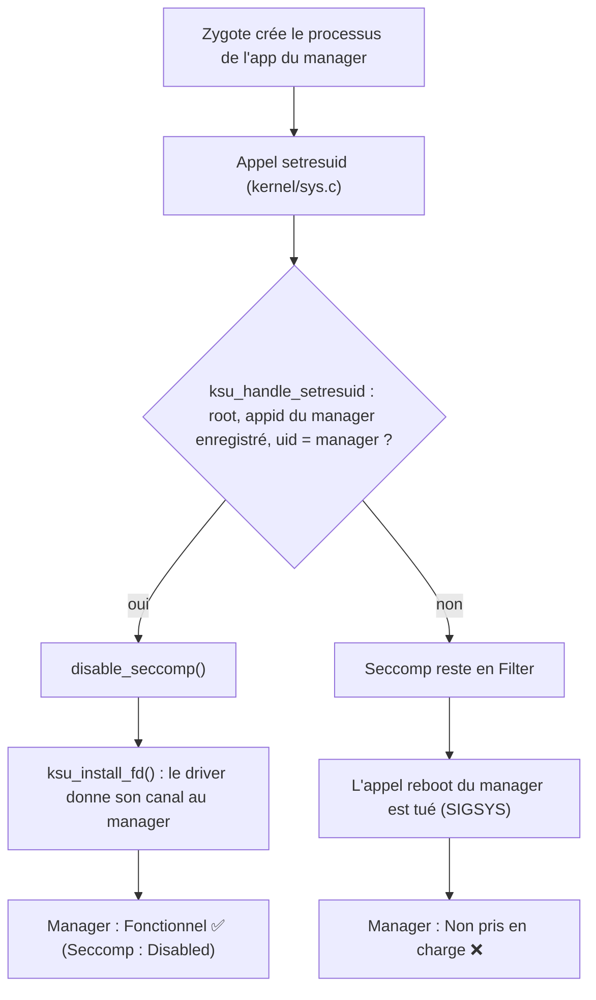

<div align="center">

# 🛡️ SukiSU-Ultra + SuSFS
### pour le noyau **4.19** (non-GKI) du **Motorola One 5G Ace** (`kiev`)

*Un noyau personnalisé avec root **et** SuSFS fonctionnels sous LineageOS 23.2 — et surtout le récit complet de tout ce qui a cassé en chemin, pour que tu n'aies pas à le revivre.*

`SukiSU-Ultra v4.3.0` · `SuSFS v2.3.0 (Inline Hook)` · `Linux 4.19.325` · `LineageOS 23.2` · `Android 16`

</div>

---

## 📖 Sommaire

1. [Pourquoi ce projet](#-pourquoi-ce-projet)
2. [Résultat](#-résultat)
3. [⚠️ À lire avant de flasher](#️-à-lire-avant-de-flasher)
4. [Contenu de la release](#-contenu-de-la-release)
5. [Installation](#-installation)
6. [Compiler soi-même (GitHub Actions)](#-compiler-soi-même-github-actions)
7. [Ce que fait le script, étape par étape](#-ce-que-fait-le-script-étape-par-étape)
8. [Les options de configuration](#-les-options-de-configuration)
9. [🧗 Les difficultés rencontrées](#-les-difficultés-rencontrées)
10. [🔬 Comment le manager reconnaît le noyau](#-comment-le-manager-reconnaît-le-noyau)
11. [Limites connues](#-limites-connues)
12. [🩺 Dépannage](#-dépannage)
13. [Crédits](#-crédits)

---

## 🎯 Pourquoi ce projet

Sur un noyau **non-GKI** (ici Linux 4.19), obtenir **SukiSU-Ultra avec SuSFS** n'a rien d'un simple « flash et c'est parti ». Il faut :

- intégrer le driver dans les sources du noyau ;
- brancher à la main des hooks dans plusieurs fichiers du noyau ;
- appliquer un patch SuSFS prévu pour le 4.19, qui ne s'applique **pas** entièrement sur une source récente ;
- éviter de casser l'écran tactile Motorola ;
- empaqueter le tout dans un `boot.img` que le bootloader accepte.

Ce dépôt documente une recette qui **fonctionne**, avec le script de build complet, les fichiers de la release, et surtout **tous les pièges** rencontrés. Si tu as vu s'afficher *« Non pris en charge »* ou *« No SukiSU kernel detected »* dans le manager, cette page est faite pour toi.

> [!NOTE]
> Ce travail vise un appareil précis. Les principes s'appliquent à d'autres noyaux 4.19 non-GKI, mais les numéros de commit, les stubs et les noms de fichiers devront être adaptés.

---

## ✅ Résultat

Capturé sur l'appareil, dans le manager SukiSU :

| Élément | Valeur affichée |
|---|---|
| État | **Fonctionnel** |
| Version du gestionnaire | `v4.3.0 (41100-6)` |
| Version du noyau | `4.19.325-cip136-st20-perf-g9426323c2ac-dirty` |
| Kernel full version | `v4.3.0-b5917072@HEAD` |
| **SuSFS** | **`v2.3.0 (SUSFS Inline Hook)`** |
| Seccomp status | `Disabled` (c'est le comportement attendu, voir [plus bas](#-comment-le-manager-reconnaît-le-noyau)) |
| SELinux | `Imposition (enforcing)` |
| Super-utilisateurs / Modules | 3 / 9 |

<!-- Ajoute tes captures dans docs/ puis décommente : -->
<!--  -->
<!--  -->

---

## ⚠️ À lire avant de flasher

> [!WARNING]
> **Flasher un noyau personnalisé peut empêcher ton téléphone de démarrer.** Tu agis sous ta seule responsabilité. Aucune garantie n'est donnée.

- Le **bootloader doit être déverrouillé**.
- **Garde sous la main le `boot.img` d'origine** de *ta* version de ROM pour pouvoir revenir en arrière.
- Cette image a été construite pour **LineageOS 23.2, build du 20/09/2026** (noyau stock `4.19.325-cip136-st20-perf`). Sur un autre build de la ROM, le risque de **kernel panic** augmente, car la source du noyau et la ROM doivent être du même moment (voir [la section sur les difficultés](#-les-difficultés-rencontrées)).
- Teste **d'abord sans écrire** avec `fastboot boot` (voir ci-dessous).
- Le bootloader peut refuser une image **plus ancienne** que celle déjà installée (voir *anti-rollback* plus bas).

---

## 📦 Contenu de la release

| Fichier | Rôle |
|---|---|
| `SukiSU-Ultra-SUSFS-v7.59-boot.img` | L'image à flasher : `boot.img` d'origine **repackée** avec le nouveau noyau, `ksud` et `su` |
| `Image-v7.59-susfs` | Le noyau brut compilé (sans repack) |
| `System.map-v7.59-susfs` | Table des symboles, utile pour vérifier ce qui est réellement compilé |
| `audit-v7.59.txt` | Rapport généré à chaque build : hooks, config, symboles SuSFS, révisions utilisées |
| `build_kernel.sh` | Le script de build complet |

---

## 🚀 Installation

### 1. Tester sans écrire (recommandé)

```bash
adb reboot bootloader
fastboot boot SukiSU-Ultra-SUSFS-v7.59-boot.img
```

Si le téléphone démarre normalement, tout va bien. Un simple redémarrage te ramène sur ton ancien `boot.img`.

### 2. Flasher définitivement

```bash
fastboot getvar current-slot          # si ton appareil est en A/B
fastboot flash boot SukiSU-Ultra-SUSFS-v7.59-boot.img
# ou, selon l'appareil : fastboot flash boot_a / boot_b
fastboot reboot
```

### 3. Installer le bon manager

> [!IMPORTANT]
> Utilise le manager **SukiSU v4.3.0 (41100-6)**, variante **standard**, et **pas** la variante « *spoofed* ».
> Le driver ne reconnaît que le package et la signature d'origine : un APK au package modifié ne sera jamais enregistré comme manager, et tu obtiendras *« Non pris en charge »* alors que le noyau est sain.

- Désinstalle l'ancien manager avant d'installer celui-ci pour éviter un conflit de signature.
- Ouvre-le : il doit afficher **Fonctionnel** et une ligne **SuSFS Version**.

### 4. Revenir en arrière

```bash
fastboot flash boot boot-stock.img
```

---

## 🏗️ Compiler soi-même (GitHub Actions)

Le script `build_kernel.sh` est prévu pour tourner sur un runner GitHub `ubuntu-latest`.

### Prérequis

1. Le `boot.img` **d'origine** de ta ROM (même date que celle installée) hébergé sur un lien Google Drive public. Renseigne son identifiant dans la variable `BOOT_GDRIVE_ID` en tête du script.
   Sans lui, le script s'arrête après la compilation et te laisse seulement l'`Image` brute (pas de `boot.img`).
2. Un dépôt GitHub avec le script dans `scripts/build_kernel.sh`.

### Workflow d'exemple (à adapter)

```yaml
name: build-kernel
on: workflow_dispatch

jobs:
  build:
    runs-on: ubuntu-latest
    steps:
      - uses: actions/checkout@v4

      - name: Build
        run: bash scripts/build_kernel.sh
        env:
          SUKI_PIN: "b5917072"        # fige le driver SukiSU (voir plus bas)
          MANAGER_FALLBACK: "1"       # active le correctif de détection du manager

      - uses: actions/upload-artifact@v4
        if: always()                   # publie même si une étape échoue
        with:
          name: kernel-output
          path: output/
```

> [!TIP]
> `if: always()` est précieux : ainsi tu récupères `audit-v7.59.txt` même quand le build échoue, et tu sais où ça a cassé.

### Les deux variables importantes

| Variable | Défaut | Effet |
|---|---|---|
| `SUKI_PIN` | *(vide)* | Fige le driver SukiSU sur un commit précis. **Laisse-la à `b5917072`.** Vide, le script prend le dernier commit de la branche `builtin`, et c'est ce qui nous a donné *« Non pris en charge »*. |
| `KERNEL_PIN` | `9426323c2acd0865fd565a6dd8a9f39f831cbec3` | Fige la **source du noyau** sur le commit validé (branche `lineage-23.2`). Vide, le script prend la dernière version de la branche, qui peut changer d'un jour à l'autre. |
| `MANAGER_FALLBACK` | `1` | Injecte un correctif qui reconnaît le manager sans dépendre des SID zygote (voir [explication](#-comment-le-manager-reconnaît-le-noyau)). Mets `0` pour désactiver. |

---

## 🧩 Ce que fait le script, étape par étape

| Étape | Rôle |
|---|---|
| **0** | Installe les dépendances (clang/LLVM, toolchains, `gdown`, etc.) et libère de l'espace sur le runner |
| **1** | Clone `LineageOS/android_kernel_motorola_sm8250`, branche `lineage-23.2` |
| **2** | Intègre **SukiSU-Ultra** en *builtin* via son `setup.sh`, puis relève (et fige si `SUKI_PIN`) le commit du driver |
| **2a** | Correctif de détection du manager sur `ksu_install_fd` (`O_CLOEXEC` → `0`) |
| **2b** | Applique le patch **SuSFS 4.19** (de JackA1ltman), puis complète à la main `fs/namespace.c` et ajoute `susfs.o` à `fs/Makefile` |
| **2c** | Supprime la déclaration et l'appel de `susfs_add_sus_avd_allowed_by_type` dans `sepolicy.c` |
| **3** | Branche les hooks « inline » SuSFS (`execveat`, `faccessat`, `stat`, `reboot`, `setresuid`, `sys_read`, `input_event`) |
| **3b** | Corrections de compatibilité 4.19 : `static_call.h`, signature de `inotify_fdinfo`, déclarations dans `fs/stat.c`, `vdso_clock_mode`, `access_ok` |
| **3c** | **Fallback de détection du manager** dans `lsm_hook.c` (voir plus bas) |
| **4** | Configuration (`vendor/lito-perf_defconfig` + options KSU/SuSFS) avec **validation stricte** : le build échoue si SuSFS est silencieusement supprimé |
| **4b** | **Audits** écrits dans `output/audit-v7.59.txt` |
| **5** | Patchs Motorola : désactive le contrôle de version des modules, ajoute le **stub tactile** dans `msm_drv.c` |
| **6** | Compile l'`Image` (clang, `LLVM=1`) |
| **7** | Compile `ksud` (Rust nightly + NDK r26d) |
| **8** | Repack avec `magiskboot` : noyau + `ksud` + `su` (setuid `06755`) dans le ramdisk |
| **9** | Résumé de sortie |

---

## ⚙️ Les options de configuration

```text
CONFIG_KSU=y
CONFIG_KSU_FEATURE_ADBROOT=y

CONFIG_KSU_SUSFS=y
CONFIG_KSU_SUSFS_SUS_PATH=y
CONFIG_KSU_SUSFS_SUS_KSTAT=y
CONFIG_KSU_SUSFS_SUS_MAP=y
CONFIG_KSU_SUSFS_SPOOF_UNAME=y
CONFIG_KSU_SUSFS_SPOOF_CMDLINE_OR_BOOTCONFIG=y
CONFIG_KSU_SUSFS_HIDE_KSU_SUSFS_SYMBOLS=y
CONFIG_KSU_SUSFS_ENABLE_LOG=y
# CONFIG_KSU_SUSFS_SUS_MOUNT is not set        <- désactivé volontairement
# CONFIG_KSU_SUSFS_OPEN_REDIRECT is not set    <- désactivé volontairement

CONFIG_KALLSYMS=y
CONFIG_KALLSYMS_ALL=y
CONFIG_SECCOMP=y
CONFIG_SECCOMP_FILTER=y
```

> [!NOTE]
> Le script ajoute aussi `CONFIG_KSU_LSM_SECURITY_HOOKS` et `CONFIG_KSU_FEATURE_SULOG`, mais ces symboles **n'existent pas** dans ce driver : `olddefconfig` les supprime sans broncher. Ce n'est pas une erreur.
> Autre piège : `CONFIG_KSU_SUSFS_HIDE_KSU_SUSFS_SYMBOLS=y` masque les symboles `susfs_*` dans `/proc/kallsyms`. Pour vérifier la présence de SuSFS, regarde donc le **`System.map`** et pas le noyau en cours d'exécution.

---

## 🧗 Les difficultés rencontrées

C'est la partie la plus utile de ce document. Ce chemin a pris **plusieurs semaines** et de nombreux builds ratés. Chaque ligne ci-dessous est un piège réel.

### Vue d'ensemble du parcours

| Tentative | Résultat |
|---|---|
| KernelSU **backslashxx** (sans SuSFS) | ✅ Démarre, tactile OK, manager fonctionnel. SuSFS patché dans les sources : ❌ plus de tactile |
| **ReSukiSU / BakaSU** + SuSFS dans les sources | ❌ Le manager ne voit jamais le noyau (blocage seccomp) |
| **KernelSU-Next** (branche legacy), sans SuSFS | ✅ après correction du protocole manager (voir plus bas) |
| SuSFS sur KernelSU-Next legacy | ❌ Erreurs d'édition de liens : le driver n'a aucun code SuSFS |
| **SukiSU-Ultra** + SuSFS 2.3.0 (premiers essais) | ❌ Kernel panic au démarrage |
| SukiSU-Ultra, driver non épinglé | ❌ *« No SukiSU kernel detected »*, puis *« Non pris en charge »* |
| **SukiSU-Ultra, driver épinglé `b5917072` + fallback** | ✅ **Fonctionnel, SuSFS v2.3.0** |

### 1. La mise à jour de LineageOS casse tout ce qui marchait

Après une mise à jour de la ROM, des builds qui fonctionnaient hier ne démarraient plus ou n'avaient plus de tactile. Plusieurs causes se sont cumulées :

- **Décalage entre la source du noyau et la ROM.** Un noyau compilé depuis des sources de début août, flashé sur une ROM du 20 septembre, a produit un **kernel panic** immédiat. La source doit dater du même moment que la ROM installée.
- **Modules vendor refusés.** Le noyau stock est compilé avec le clang d'Android et des protections (LTO, CFI, ShadowCallStack, MODVERSIONS), alors que le runner GitHub utilise le clang d'Ubuntu. Résultat dans les logs : tous les modules (tactile, Wi-Fi, audio, capteurs…) étaient rejetés avec `disagrees about version of symbol module_layout`, **même avec une chaîne de version identique**. Contournement : désactiver le contrôle `check_version` dans `kernel/module.c` (étape 5 du script).
- **Écran tactile.** Le fabricant fournit des fonctions que le pilote attend (`panel_register_notifier`, `touch_set_state`). Un **stub** dans `techpack/display/msm/msm_drv.c` les fournit. Observation : un build qui avait le stub gardait le tactile, un build équivalent sans stub le perdait. C'est l'**hypothèse la plus probable** de cause, mais elle n'a pas été isolée de façon formelle.

### 2. Le bootloader refuse certaines images

- **Anti-rollback AVB** : tester un `boot.img` plus ancien (`fastboot boot`) fait simplement redémarrer le téléphone sur la ROM installée. L'image est rejetée silencieusement. Impossible donc de comparer avec une ancienne version de la ROM pour isoler un bug.
- **Repack incompatible** : une image produite par un ancien script Python de repack (header Android boot v2 + footer AVB mal gérés) provoquait un kernel panic. **`magiskboot repack`** à partir du vrai `boot.img` d'origine, lui, produit une image valide.

### 3. Le piège seccomp (le plus vicieux)

Symptôme : le manager affiche *« le noyau n'est pas détecté »*, et `ksud` répond dans les logs :

```
KernelSU driver install syscall was blocked by seccomp
could not retrieve kernelsu driver fd
```

Un test sans root dans Termux a confirmé : l'appel `reboot(0xDEADBEEF, 0xCAFEBABE, …)` — le « coup de sonnette » du manager vers le driver — **tue le processus avec SIGSYS (code 159)**. Le filtre seccomp des applications Android bloque l'appel **avant même** qu'il atteigne le driver. Aucun hook dans `reboot` ne peut donc réparer ça.

Le driver contourne le problème autrement : au moment où l'app du manager est créée (appel `setresuid` de zygote), il **désactive le seccomp du processus** et lui ouvre directement le canal. C'est pour ça que *« Seccomp : Disabled »* est la bonne valeur dans le manager, pas un réglage à forcer à la compilation. Voir [la section dédiée](#-comment-le-manager-reconnaît-le-noyau).

### 4. Le message trompeur « seulement les noyaux GKI »

Quand le manager n'arrive pas à joindre le driver, il affiche :

> *« SukiSU prend désormais en charge seulement les noyaux GKI… »* — **Non pris en charge**

**Ce message est générique.** Il ne veut pas dire que ton noyau est incompatible : il veut dire *« je n'ai pas pu parler au driver »*. Le seul indice utile est la ligne **Seccomp status : Filter** (au lieu de *Disabled*) sur cet écran.

### 5. Le driver « le plus récent » n'est pas le bon

Avec `setup.sh builtin`, on récupère le **dernier commit** de SukiSU-Ultra. Sur ce noyau, ce dernier commit donnait *« Non pris en charge »*, alors que le commit **`b5917072`** (celui d'un build précédent qui fonctionnait) marche. D'où la variable **`SUKI_PIN`**. Corollaire : un build n'est **reproductible** que si le driver est figé.

Autre conséquence de ce décalage : `ksud` doit être compilé depuis la même révision que le driver, mais le dossier `userspace/ksud` **n'existe pas** au commit `b5917072`. Le script bascule alors sur `main` pour `ksud`. C'est un petit décalage assumé, qui n'empêche pas le fonctionnement ici.

### 6. Le manager et le noyau doivent parler le même protocole (KernelSU-Next)

Sur la branche *legacy* de KernelSU-Next, le manager officiel affichait *« manager version 5 is too low, upgrade to 6 or higher »*. Cause : un commit du driver (« preinit ») avait fait passer l'UAPI de la version 5 à 6. Solution : **épingler le driver sur le commit juste avant** ce changement et compiler `ksud` depuis le tag correspondant. Leçon valable partout : **versions du manager, du driver et de `ksud` doivent être cohérentes**.

### 7. Les patchs SuSFS pour 4.19 ne s'appliquent pas proprement

Le patch SuSFS 4.19 touche une vingtaine de fichiers. Sur cette source, **plusieurs blocs échouent** :

| Fichier | Bloc | Conséquence |
|---|---|---|
| `fs/namespace.c` | #1 et #6 | Partie `SUS_MOUNT` (désactivée) |
| `fs/super.c` | #1 | Partie `SUS_MOUNT` (désactivée) |
| `fs/proc/task_mmu.c` | #7 | Concerne `SUS_MAP`, **activée** : probablement incomplète |

Autres embûches rencontrées :

- **Symboles non définis à l'édition de liens** (`susfs_is_current_ksu_domain`, `susfs_ksu_sid`, `susfs_priv_app_sid`) : le driver KernelSU-Next legacy n'a **aucun** code SuSFS, il faut un driver qui l'intègre.
- **`CMD_SUSFS_SET_PRIORITY_UID_FILTER` non déclaré** : le driver SukiSU récent attend un SuSFS plus neuf que le patch utilisé.
- **Kernel panics** avec certains builds SuSFS 2.3.0, avant d'épingler le driver.
- **SuSFS patché dans les sources + driver tactile custom** : conflit systématique dans les premiers essais.

### 8. La source du noyau elle-même bouge (« ça compilait hier »)

Le jour où le dépôt `LineageOS/android_kernel_motorola_sm8250` a changé sa branche par défaut (passage à `lineage-24.0`, le 3 novembre 2026), le **même script, sans aucune modification**, s'est mis à échouer dès la première compilation :

```
error: unknown warning option '-Wno-cast-function-type-strict'; did you mean '-Wno-cast-function-type'? [-Werror,-Wunknown-warning-option]
make[2]: *** [.././Kbuild:21: kernel/bounds.s] Error 1
```

Le flag est passé à **toutes** les compilations du noyau, mais le clang du runner GitHub ne le connaît pas. Hypothèse retenue : un commit récent de la branche `lineage-23.2` ajoute ce flag, prévu pour le clang d'Android, plus récent. Il n'a aucun rapport avec SuSFS.

**Leçon : fige aussi la source du noyau**, pas seulement le driver. C'est le rôle de `KERNEL_PIN`. Par sécurité, le script active en plus un petit *wrapper* clang qui ignore les options inconnues quand clang est plus ancien que la version 16.

> [!TIP]
> Note le SHA complet de ta source après chaque build réussi : `audit-v7.59.txt` l'affiche (`SHA complet de la source`).

#### Le patch SuSFS bouge lui aussi

Le script télécharge le patch SuSFS 4.19 et le script de hooks depuis la branche `mainline` du dépôt de Jack : ce sont **deux entrées non figées de plus**. Un patch récent y ajoute des fonctions « priority uid filter » (`getpriority`/`setpriority`) et fait échouer le build de deux façons :

- dans `fs/susfs.c`, le bloc `#ifdef CONFIG_KSU_SUSFS_PRIORITY_UID_FILTER` n'est **jamais refermé** (`unterminated conditional directive`) : il avale tout ce qui suit dans le fichier ;
- les prototypes des fonctions sont conditionnés à ce même symbole, alors que le driver les appelle sans condition (`implicit declaration of function 'susfs_set_priority_uid_filter'`).

Le correctif consiste à insérer le `#endif` manquant **juste après la dernière fonction du bloc** (et non en fin de fichier, ce qui ferait disparaître `susfs_init` et les fonctions de version si l'option est désactivée), puis à activer le symbole.

> [!TIP]
> Garde une copie de chaque entrée externe dans ton dépôt (`patches/susfs_patch_to_4.19.patch` et `patches/susfs_inline_hook_patches.sh`) et fais lire ces copies par le script. Le build devient reproductible, et tu vois exactement ce qui a changé quand tu les mets à jour.

### 9. Les pièges du script lui-même

Des heures perdues sur des erreurs de syntaxe sans rapport avec le noyau :

- **Dernière ligne tronquée** lors d'un copier-coller depuis un téléphone (`outPYPYEOF` à la place de `output/"`). Résultat : `unexpected EOF while looking for matching '"'` et code de sortie 2, **alors que tout avait compilé**. Toujours vérifier avec `bash -n script.sh` avant de lancer.
- **Guillemets typographiques** (`“ ”`) glissés par le clavier : à bannir dans un script.
- **`set -e` + `grep`** : un `grep` qui ne trouve rien fait échouer tout le script. Les commandes d'audit finissent donc par `|| true`.
- **Un `cd` vers un dossier qui n'existe pas** (`userspace/ksud`) arrête le build : le script cherche maintenant le crate `ksud` dynamiquement.
- **L'audit initial ne vérifiait que la présence des noms** (`grep -q`). Un nom présent seulement dans un `extern` donne un faux ✅. L'audit affiche maintenant les **lignes réelles**.

---

## 🔬 Comment le manager reconnaît le noyau

Avec `CONFIG_KSU_SUSFS=y`, le chemin de détection du manager **change** par rapport à un build sans SuSFS : le hook LSM habituel est remplacé par un hook dans l'appel système `setresuid`.



Ce qui est établi par l'audit du build :

- Les hooks `execveat`, `faccessat`, `stat`, `reboot`, `setresuid`, `sys_read` et `input_event` sont tous **présents et réellement appelés**, pas seulement déclarés.
- `ksu_handle_setresuid`, `disable_seccomp`, `ksu_install_fd` et `ksu_handle_execveat` sont **présents dans le `System.map`**.
- Les **85 symboles `susfs_*`** sont compilés.
- Les SID SELinux (zygote, init, etc.) sont initialisés par `apply_kernelsu_rules()` au *second stage* de `init` ; le manager est enregistré par un suivi de `packages.list` (*throne tracker*).

### Le fallback `MANAGER_FALLBACK`

Le hook d'origine, en mode SuSFS, n'agit que si le processus parent est reconnu comme **zygote par son SID**. Le script ajoute, **avant** ce test, la logique du chemin « sans SuSFS » : si l'appid du manager est enregistré et que le processus devient cet uid, on désactive le seccomp et on installe le canal.

> [!NOTE]
> **Honnêteté : on ne sait pas lequel des deux changements a débloqué la situation.** Le build qui marche cumule *le driver épinglé* **et** *le fallback*. Pour le savoir, il suffit de refaire un build avec `MANAGER_FALLBACK=0` et de comparer. En attendant, garde les deux.

---

## 🚧 Limites connues

- **SuSFS partiel** : `SUS_MOUNT` et `OPEN_REDIRECT` sont désactivés, et des blocs du patch ont échoué ; `SUS_MAP` est probablement incomplet. Les fonctions `SUS_PATH`, `SUS_KSTAT`, le spoof d'`uname` et de la cmdline sont, elles, compilées.
- **Fonction supprimée dans `sepolicy.c`** : l'appel à `susfs_add_sus_avd_allowed_by_type` est retiré (étape 2c). Cette fonction **existe** bien dans `fs/susfs.c` dans ce build, donc cette suppression est peut-être devenue inutile. Elle n'a pas été retestée sans.
- **Chaîne de version différente du stock** : le noyau annonce `…-g9426323c2ac-dirty` (branche `lineage-23.2`), alors que le noyau stock du 20/09/2026 est `…-gc21b90c6860e`. Ça n'a pas empêché le démarrage, mais peut compter pour certains modules.
- **`ksud` et driver de révisions différentes** (voir difficulté n°5).
- **Dépendance à la date de la ROM** : build validé sur LineageOS 23.2 du **20/09/2026**.
- **Zygisk Next** peut afficher « redémarrage requis » : un simple reboot suffit.
- **Modules SuSFS userspace** : le noyau fournit SuSFS v2.3.0 ; choisis un module compatible avec cette version. Les combinaisons n'ont pas toutes été testées.

---

## 🩺 Dépannage

<details>
<summary><b>« Non pris en charge » / « No SukiSU kernel detected »</b></summary>

1. Vérifie la ligne **Seccomp status** : si elle indique **Filter**, le driver n'a pas pu désactiver le seccomp du manager.
2. Vérifie que tu utilises le manager **standard** `v4.3.0 (41100-6)` et pas « spoofed ».
3. Si tu compiles toi-même : `SUKI_PIN` doit être défini (`b5917072`).
4. Avec un PC, regarde le journal du noyau :
   ```bash
   adb root
   adb shell dmesg | grep -iE "ksu|susfs|sid|manager"
   ```
   Cherche des lignes du type `second_stage executed`, `Cached zygote SID`, et `install fd for manager (fallback)`. La première ligne absente indique où ça casse.
   *(`adb root` suppose une ROM en build `userdebug`.)*
</details>

<details>
<summary><b>Le téléphone redémarre en boucle ou sur le recovery</b></summary>

- Reflash le `boot.img` d'origine de ta ROM.
- Vérifie que la ROM installée correspond à la date de build de l'image (voir [difficulté n°1](#1-la-mise-à-jour-de-lineageos-casse-tout-ce-qui-marchait)).
</details>

<details>
<summary><b>Plus de tactile</b></summary>

- Vérifie que le **stub** `msm_drv.c` (étape 5) a bien été appliqué dans l'audit/log.
- Compare avec le `boot.img` d'origine pour confirmer que le problème vient du noyau.
</details>

<details>
<summary><b>Le build échoue sans raison apparente</b></summary>

- Lance `bash -n scripts/build_kernel.sh` : une ligne tronquée ou un guillemet typographique sont les coupables habituels.
- Télécharge `audit-v7.59.txt` : il liste les patchs rejetés, la config finale et les révisions utilisées. Pense à `if: always()` dans le workflow.
</details>

<details>
<summary><b>Je veux vérifier que SuSFS est bien compilé</b></summary>

```bash
grep -ci " susfs_" System.map-v7.59-susfs      # attendu : environ 85
grep -E " (ksu_handle_setresuid|disable_seccomp|ksu_install_fd)$" System.map-v7.59-susfs
```
Utilise le `System.map` du build, pas `/proc/kallsyms` (les symboles y sont masqués).
</details>

---

## 🙏 Crédits

Ce projet n'existerait pas sans le travail des autres :

- **[SukiSU-Ultra](https://github.com/SukiSU-Ultra/SukiSU-Ultra)** — ShirkNeko et contributeurs, driver et manager
- **[KernelSU](https://github.com/tiann/KernelSU)** — tiann (weishu) et contributeurs
- **SuSFS** — simonpunk et contributeurs
- **[JackA1ltman/NonGKI_Kernel_Build_2nd](https://github.com/JackA1ltman/NonGKI_Kernel_Build_2nd)** — patchs SuSFS pour 4.19 et scripts de hooks inline
- **[LineageOS](https://lineageos.org/)** — sources du noyau `android_kernel_motorola_sm8250`
- **[Magisk](https://github.com/topjohnwu/Magisk)** — `magiskboot` pour le repack
- Les projets explorés en chemin : KernelSU-Next, ReSukiSU, BakaSU, backslashxx

## 📜 Licence

Le noyau Linux et les parties du driver KernelSU placées dans `kernel/` sont sous **GPL-2.0**. Le script et la documentation de ce dépôt sont fournis **sans garantie**, à titre d'information.

<div align="center">

*Si ce dépôt t'a évité une semaine de galère, laisse une ⭐ — et si tu trouves mieux, ouvre une issue !*

</div>
